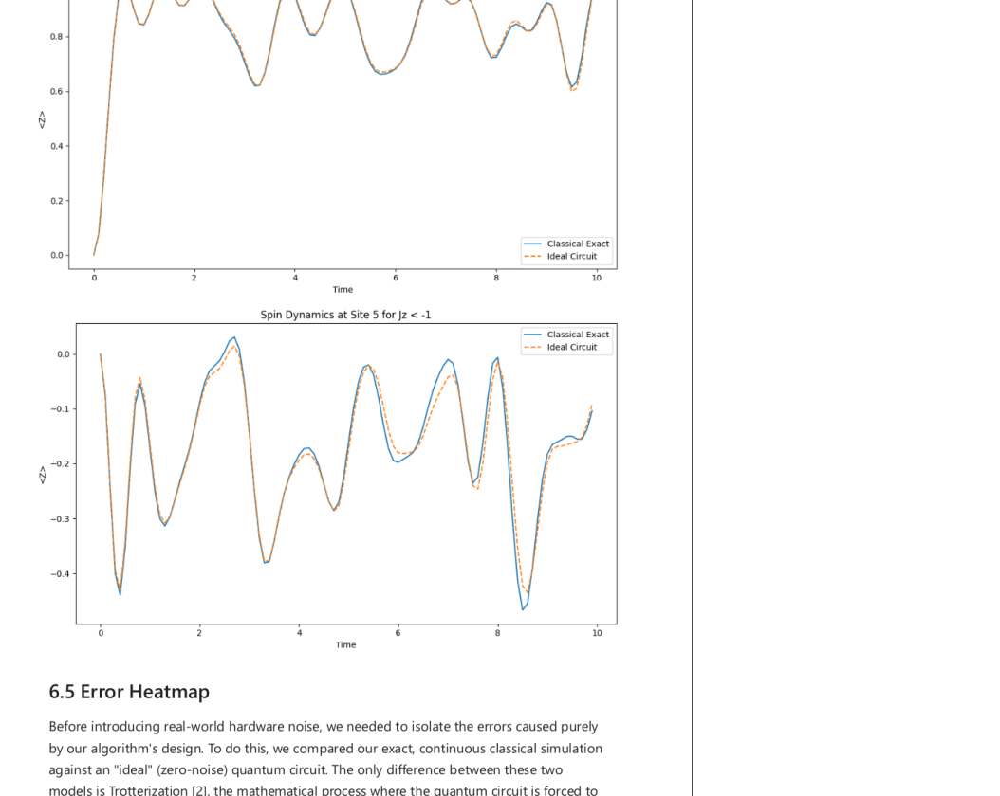
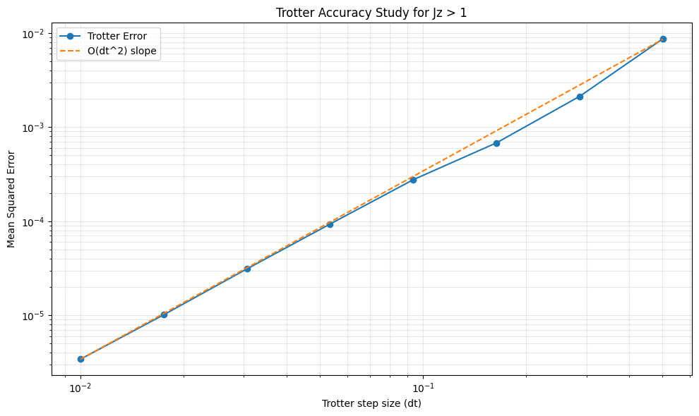
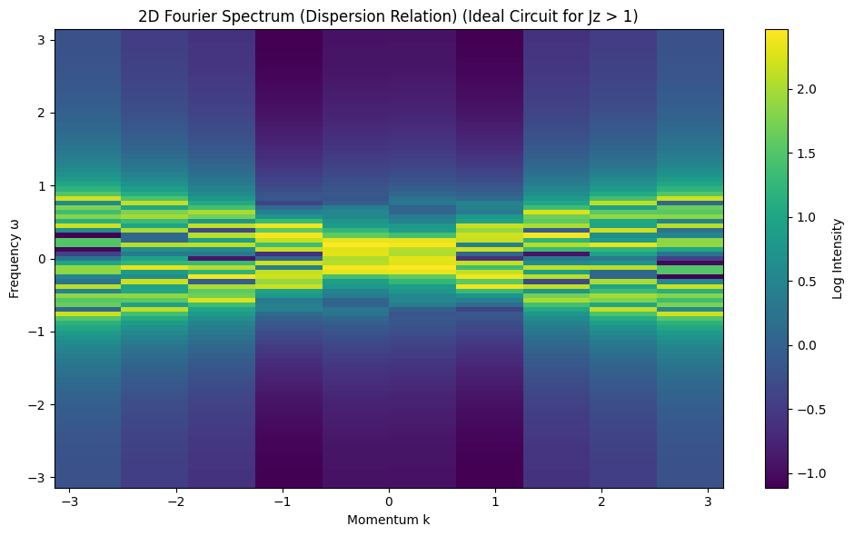
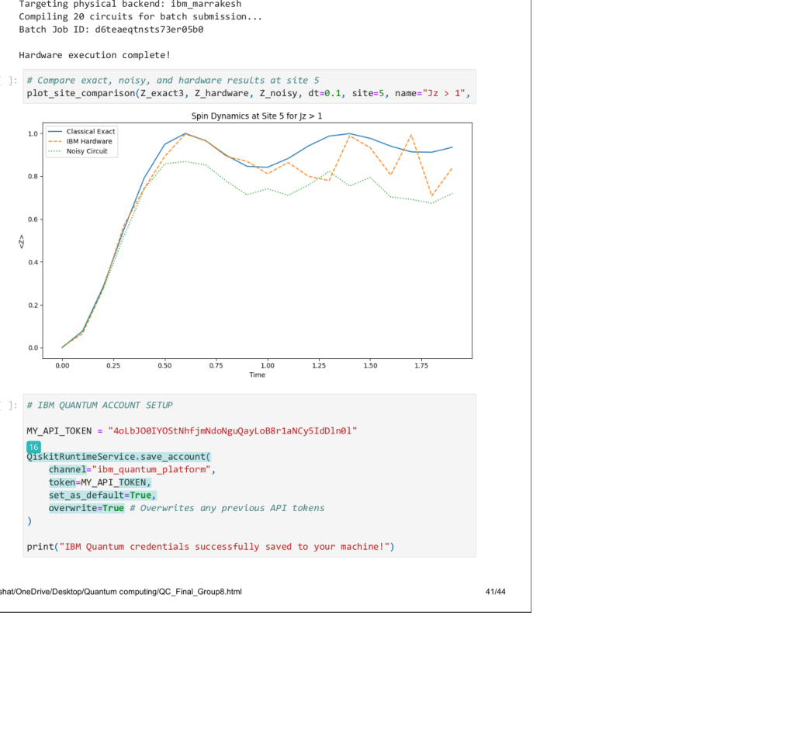

# Quantum Simulation of the XXZ Spin Chain

Collaborative quantum-computing project completed at the University of Edinburgh.

This project investigates real-time dynamics in a one-dimensional XXZ spin chain using Trotterized quantum circuits. The circuit results are benchmarked against classical exact time evolution, then extended to Trotter-error studies, momentum-frequency analysis, hardware-informed noise simulation and an IBM Quantum hardware run.

## My contribution — Saqib Umair

My recorded contribution to the group project was:

- initial-state preparation;
- local Pauli observables;
- Fourier analysis of the spin dynamics;
- analysis and interpretation of IBM Quantum hardware results.

The project was completed by **Bhoopesh Dosieah, Saqib Umair, Anay Chadha, Shailesh Devarasu, Akshat Dalmia and Hamish Cranston**. The full contribution breakdown is provided in [CONTRIBUTIONS.md](CONTRIBUTIONS.md).

## Analysis workflow

The study compares four levels of description:

1. **Ideal Trotterized circuit simulation** of the XXZ Hamiltonian.
2. **Classical exact time evolution** as the numerical reference.
3. **Noise-aware circuit simulation** using an IBM backend-informed noise model.
4. **IBM Quantum hardware execution** for a reduced real-device study.

Two initial-state regimes are explored: ferromagnetic/vacuum-like and antiferromagnetic/Néel-like configurations, each with a local perturbation.

## Classical versus Trotterized evolution

The classical exact solution and ideal quantum-circuit simulation reproduce the same qualitative propagation pattern at early and intermediate times. Differences accumulate as the Trotter approximation error grows.



This comparison is used as a direct validation of the circuit construction before moving to noisy simulation or real hardware.

## Trotter error scaling

The project studies how the simulation error changes with timestep. Reducing the timestep improves the approximation until numerical precision and computational cost become relevant.



This provides a practical trade-off between circuit depth and numerical accuracy.

## Fourier analysis

My main analytical contribution was the momentum-frequency study of the simulated spin dynamics.

A two-dimensional Fourier transform is applied to the space-time observable data to identify the dominant propagation structure in frequency and momentum space.



The ideal circuit and classical exact calculations show closely related dominant spectral features, indicating that the Trotterized circuit preserves the main propagation physics even when smaller amplitude-level differences remain.

## Noise and IBM Quantum hardware

The analysis then introduces a backend-informed noise model and compares the resulting dynamics with the ideal and exact calculations.

The final hardware study was executed on IBM Quantum hardware by **Hamish Cranston**. My contribution was the **analysis and interpretation of the hardware results**.



The hardware data reproduce the expected short-time trend but deviate more strongly at later times as circuit depth and hardware noise accumulate.

## Group contribution record

| Contributor | Recorded contribution |
|---|---|
| **Bhoopesh Dosieah** | XXZ Hamiltonian implementation; introduction; analysis methodology; site comparison |
| **Saqib Umair** | Initial states; observables; Fourier analysis; IBM result analysis |
| **Anay Chadha** | Trotter circuit; accuracy evaluation |
| **Shailesh Devarasu** | Classical exact benchmarks; time-evolution algorithm |
| **Akshat Dalmia** | Quantum-circuit evolution; noisy-circuit evolution; simulations; code integration |
| **Hamish Cranston** | Fourier plots; IBM hardware execution |

## Notebook

The complete public analysis notebook is available here:

[**Open the Jupyter notebook**](notebooks/XXZ_spin_chain_quantum_simulation.ipynb)

It contains the Hamiltonian implementation, state preparation, observables, Trotter circuits, classical evolution, error studies, Fourier analysis, noisy simulation and IBM-hardware workflow.

## Repository structure

```text
.
├── README.md
├── CONTRIBUTIONS.md
├── ACKNOWLEDGEMENTS.md
├── PROJECT_NOTE.md
├── requirements.txt
├── notebooks/
│   └── XXZ_spin_chain_quantum_simulation.ipynb
└── figures/
    ├── site_comparison.png
    ├── trotter_accuracy_scaling.png
    ├── fourier_spectrum.png
    └── ibm_hardware_comparison.png
```

## Public-version changes

The notebook is based on the original group notebook. Before public release:

- student identification numbers were removed;
- a hard-coded IBM Quantum API credential was removed;
- credential setup was replaced with an environment-variable workflow.

The scientific code, analysis outputs and contribution record were otherwise preserved.

## Tools

Python · Qiskit · NumPy · SciPy · Matplotlib · IBM Quantum

## Acknowledgement

This repository presents a collaborative group project and does not claim sole authorship. I acknowledge the contributions of **Bhoopesh Dosieah, Anay Chadha, Shailesh Devarasu, Akshat Dalmia and Hamish Cranston**.

See [ACKNOWLEDGEMENTS.md](ACKNOWLEDGEMENTS.md) for the full acknowledgement statement.
