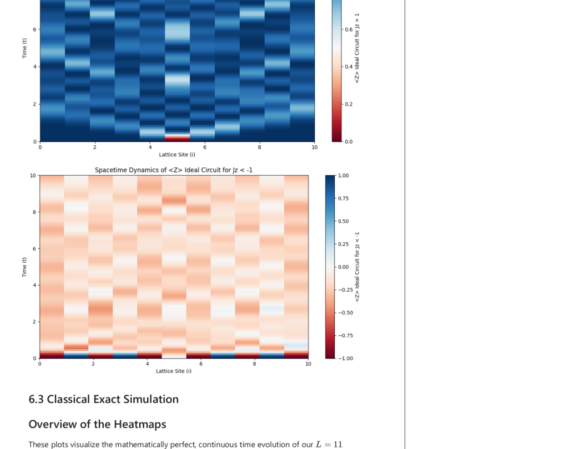
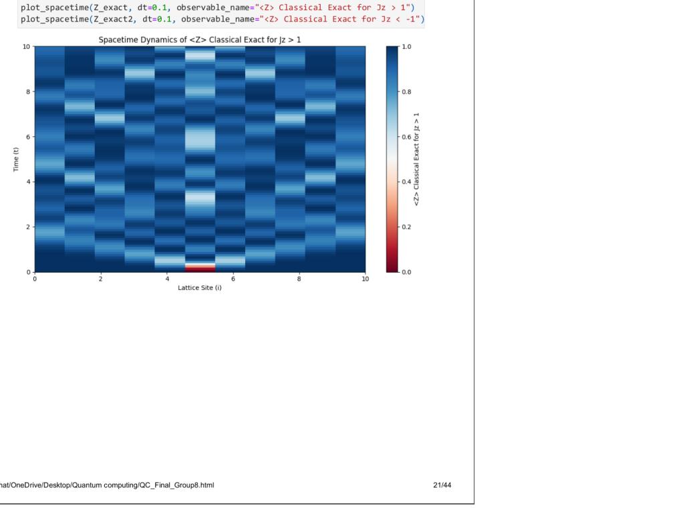
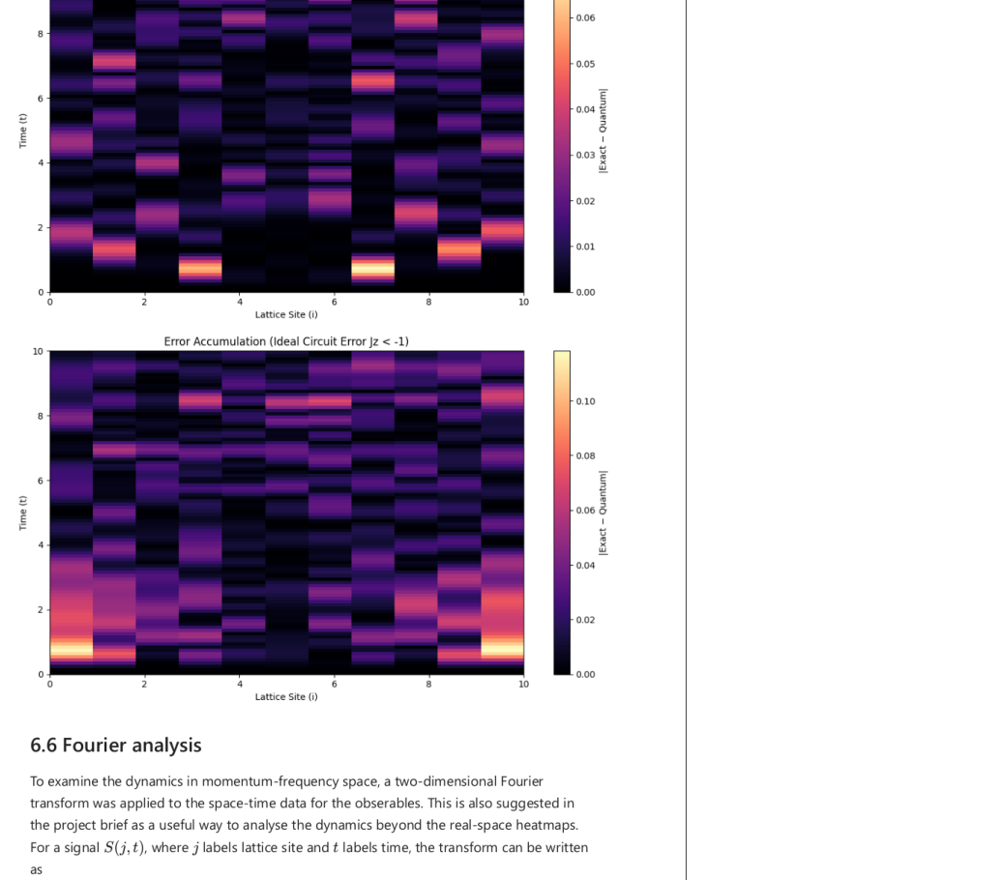
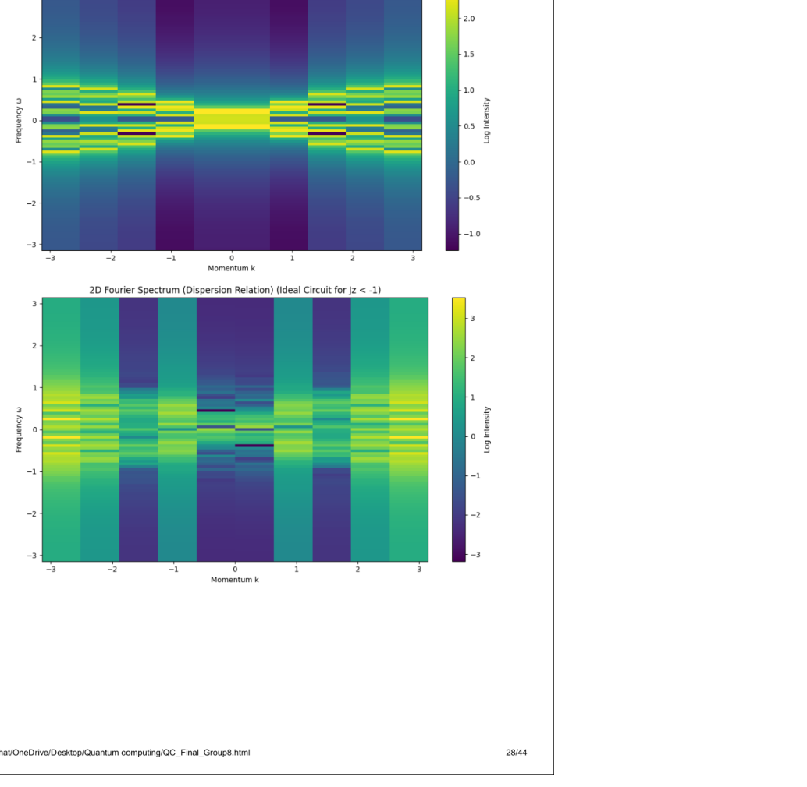
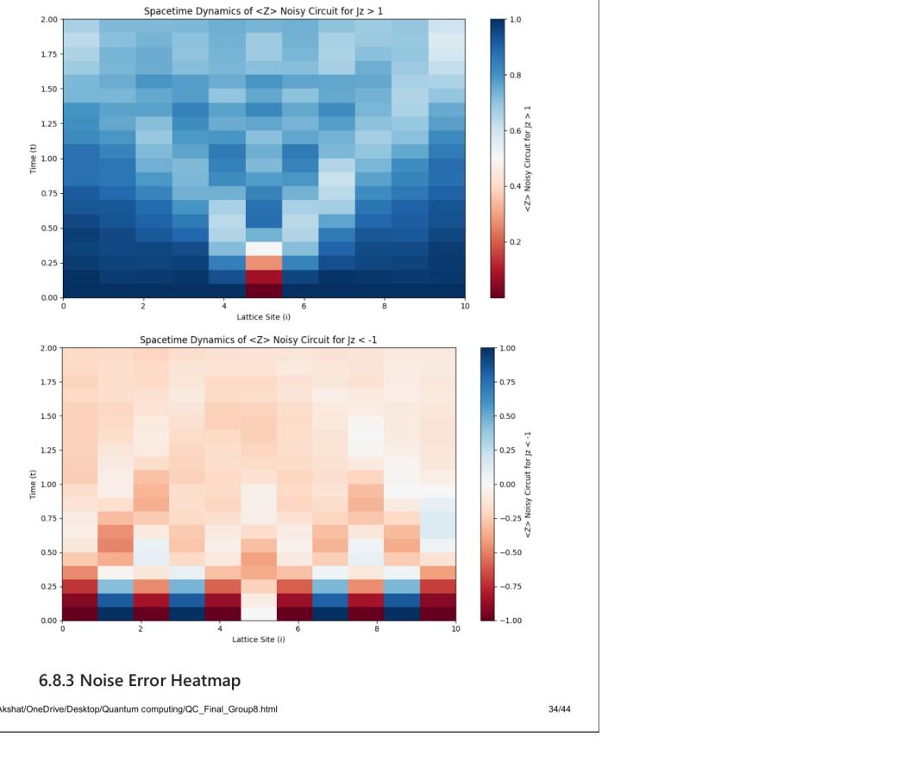
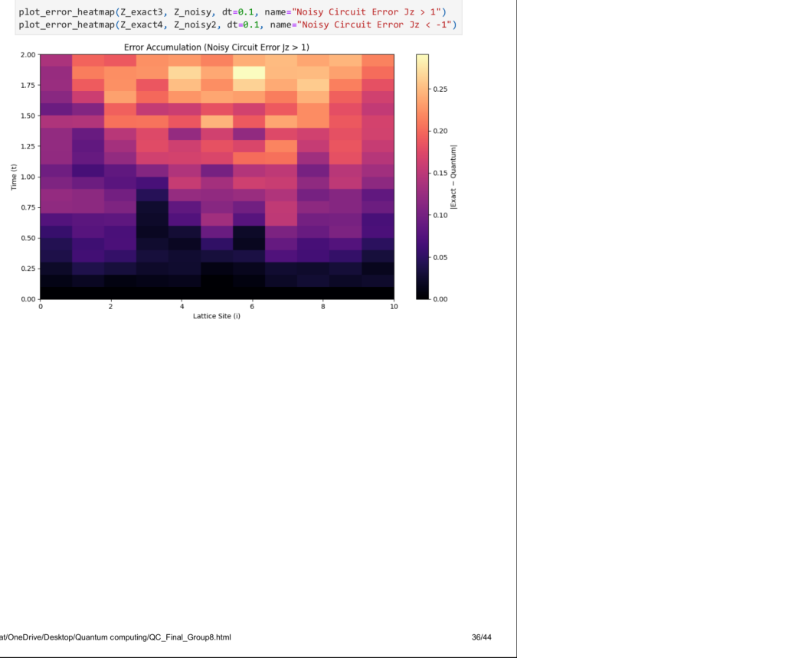

# Quantum Simulation of the XXZ Spin Chain

Personal portfolio summary of a six-person University of Edinburgh group project.

This project studies the real-time dynamics of a one-dimensional XXZ spin chain using Trotterized quantum circuits, classical exact simulation, noisy circuit models, Fourier analysis and execution on IBM Quantum hardware.

## My contribution — Saqib Umair

According to the contribution record in the submitted group report, my assigned areas were:

- Initial-state preparation
- Local observables
- Fourier analysis
- IBM hardware result analysis

This repository is not presented as solely my work. The work of the other group members is acknowledged in CONTRIBUTIONS.md and ACKNOWLEDGEMENTS.md.

## Project workflow

The group project compared ideal Trotterized quantum-circuit evolution with classical exact time evolution, Trotter-error studies, Fourier analysis, noisy-circuit simulation and execution on IBM Quantum hardware.

## Fourier analysis

My contribution included the Fourier-analysis stage and interpretation of the spin-chain dynamics in momentum-frequency space.

## Noisy circuit simulation

## IBM Quantum hardware

The hardware execution itself was performed by Hamish Cranston. My recorded contribution was analysis and interpretation of the IBM hardware results.

## Group attribution

See CONTRIBUTIONS.md for the detailed contribution record and ACKNOWLEDGEMENTS.md for collaborator acknowledgements.

## Scope

The original submitted report and Turnitin appendix are not included here. The selected figures were extracted from the group report for portfolio presentation. Source code has not been reconstructed from screenshots in the report.

## Tools and methods

Python, Qiskit, Suzuki-Trotter decomposition, local Pauli observables, classical matrix time evolution, 2D Fourier analysis, noisy-circuit simulation and IBM Quantum hardware.